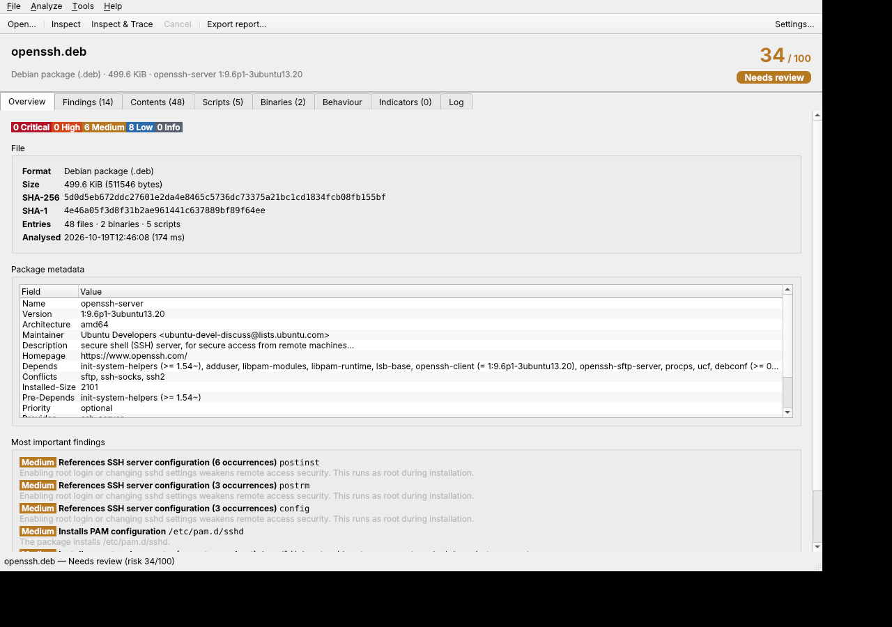

# PkgScope

**Inspect Linux packages, AppImages and binaries — and watch what they actually do in an isolated, no‑root sandbox — before you install them.**

A native **Qt 6 / C++** desktop app (plus a scriptable CLI) that unpacks a package without installing it, builds a tree of *what goes where*, flags suspicious components, and can execute the installer inside a throwaway sandbox to record every file it touches and every host it contacts. Your real system is never modified. It follows your system colour scheme and theme.



---

## What it does

### 1. Static inspection (never executes anything)
Drop in a file and PkgScope detects the format and unpacks it in memory / a private temp dir:

| Family | Formats |
|---|---|
| Debian | `.deb`, `.ipk` (OpenWrt/opkg) |
| RPM | `.rpm` (own bounds‑checked header reader) |
| Arch | `.pkg.tar.zst` / `.xz` / `.gz` (pacman) + `.INSTALL`, `.MTREE` |
| Alpine | `.apk` |
| Void | `.xbps` |
| Slackware | `.txz` / `.tgz` + `doinst.sh` |
| Bundles | AppImage (type 1 & 2), Snap, SquashFS |
| Single files | ELF executables & shared objects, kernel modules, shell/Python/Perl scripts, makeself installers |

For each it shows:

- **A full file tree** — install path, mode, owner, size, SHA‑256, with setuid/setgid, world‑writable, hidden and device‑node files highlighted.
- **Install scripts** (preinst/postinst/…, `%pre`/`%post`, `.INSTALL`, `doinst.sh`) with the exact **lines that triggered a rule highlighted**.
- **ELF analysis** — type, PIE/NX/RELRO/canary/FORTIFY, RPATH/RUNPATH, notable imports, UPX/packing, and **shared libraries that re‑implement libc functions** (the classic `LD_PRELOAD` rootkit pattern).
- **Indicators** — URLs, IPs, domains and `.onion` addresses, with schema/documentation URLs filtered out.
- **Integrity** — verifies every file against the package's own checksums (`md5sums`, RPM digests, `.MTREE`) and reports mismatches (tampering) and files missing from the list.
- **100+ heuristics** across download‑and‑pipe‑to‑shell, reverse shells, cron/systemd/PAM/udev persistence, credential theft, miners, anti‑forensics and destructive commands — each with a severity, an explanation of *why it matters*, and the evidence.

Everything rolls up into a **0–100 risk score** and a plain‑language verdict.

### 2. Behaviour tracing (the sandbox)
Press **Inspect & Trace** and PkgScope *runs* the installer — safely. It simulates the real package‑manager sequence (e.g. dpkg `preinst → unpack → postinst`, rpm `%pre → unpack → %post`, pacman `pre_install → … → post_install`) as a **fake root** inside:

- **user + mount + PID + IPC + UTS + cgroup + (by default) network namespaces** — no root, no setuid helper;
- a **copy‑on‑write overlay** over your real `/usr`, `/etc`, … so nothing on your disk is ever changed;
- a **dropped capability bounding set**, **rlimits**, and a **seccomp‑BPF filter** that blocks module loading, `bpf`, `kexec`, mounting, raw namespace creation, `io_uring`, and more.

It then reports, from an `strace` of the run:

- the **process tree** (every command executed, with arguments and exit status);
- **file activity** — everything created, modified, deleted, chmod/chown'd, plus sensitive reads (`/etc/shadow`, SSH keys, browser profiles, wallets…), *including attempts that the sandbox blocked*;
- a **filesystem diff** — exactly which files the install added or changed vs. your real system;
- **network** — every connection and DNS/SNI/HTTP host it tried to reach (isolated by default, so attempts are recorded but fail);
- any **dropped executables run at install time** (the dropper pattern that static analysis can't see), which are then analysed too.

Everything is **cleaned up automatically** when the scan finishes — no leftovers.

### 3. Reports
Export a self‑contained **HTML**, **JSON** (full machine‑readable detail) or **Markdown** report. The CLI can gate CI pipelines with `--fail-on`.

---

## Install

### Arch Linux
```sh
cd packaging
# create a source tarball next to the PKGBUILD first (see PKGBUILD header), then:
makepkg -si
```
Pulls in `qt6-base libarchive bubblewrap squashfs-tools strace`.

### AppImage (any distro, no root)
Download `PkgScope-x.y.z-x86_64.AppImage`, then:
```sh
chmod +x PkgScope-*.AppImage
./PkgScope-*.AppImage                 # GUI
./PkgScope-*.AppImage --cli <file>    # command line
```
Qt and libarchive are bundled. For **behaviour tracing** the host still needs `strace`, `bubblewrap`‑style namespaces and (for AppImage/Snap contents) `squashfs-tools` — install them with your package manager; static inspection works without them.

### Build from source
```sh
./install.sh                     # build + install to /usr/local
./install.sh --prefix ~/.local   # per-user, no root
./uninstall.sh                   # clean removal (uses the install manifest)
```
**Build deps:** `cmake` (≥3.19), a C++20 compiler, `qt6-base` dev, `libarchive` dev.
**Runtime (tracing):** `strace`, `squashfs-tools`; unprivileged user namespaces enabled.

---

## Enabling the sandbox

Behaviour tracing needs **unprivileged user namespaces**. Most distros allow them by default. Check from the app via **Analyze → Check sandbox support**, or:

- **Debian/Ubuntu 24.04+** restrict them via AppArmor. Install the bundled profile:
  ```sh
  sudo install -Dm644 packaging/apparmor/pkgscope-sandbox /etc/apparmor.d/pkgscope-sandbox
  sudo apparmor_parser -r /etc/apparmor.d/pkgscope-sandbox
  ```
- **Older Debian:** `sudo sysctl kernel.unprivileged_userns_clone=1`
- Static inspection always works, with or without the sandbox.

---

## CLI

```sh
pkgscope-cli <file>                      # static inspection
pkgscope-cli --trace <file>              # also run it in the sandbox
pkgscope-cli --trace --allow-network <file>
pkgscope-cli <file> --json out.json --html out.html --md out.md
pkgscope-cli --trace --fail-on high <file>   # exit 3 if a High+ finding exists (CI)
```

---

## How it's built

- **Core** (`src/core`) — no UI, no Qt Widgets: format detection, a bounds‑checked ELF parser and RPM header reader, a `libarchive` wrapper with a **symlink‑safe, traversal‑proof extractor** (`openat`‑beneath‑root, zip‑bomb limits), the heuristic content scanner, the `strace` parser and the sandbox orchestrator.
- **Sandbox helper** (`src/sandbox/sandbox_main.cpp`) — a small, **Qt‑free, non‑setuid** C++ program that sets up the namespaces, overlay, capabilities, rlimits and seccomp filter. This is the only part that needs the kernel's namespace support.
- **GUI** (`src/gui`) — native Qt 6 Widgets; respects the system palette, with explicit light/dark themes.
- **CLI** (`src/cli_main.cpp`) — the same core, headless.

### Safety of the tool itself
PkgScope parses hostile files, so it is hardened accordingly: every parser is bounds‑checked and fuzzed under ASan/UBSan, archive extraction refuses path traversal / absolute paths / symlink escapes, and the sandbox helper drops privileges before it ever touches the target. Static analysis **never executes** the input.

> Static heuristics and a single sandboxed run can't *prove* a file is safe — they surface behaviour worth reviewing. Treat a clean result as "nothing obvious found," not a guarantee.

## License
MIT — see [LICENSE](LICENSE).
