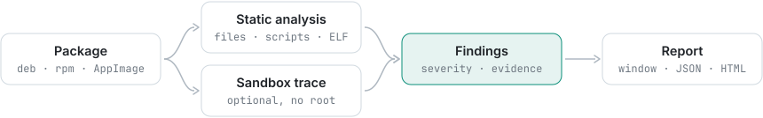

<div align="center">


# PkgScope

See inside Linux packages before you install them.

[](https://github.com/Trendorin/pkgscope/releases/latest)
[](LICENSE)


[Download](https://github.com/Trendorin/pkgscope/releases/latest) · [Install](#install) · [Wiki](docs/wiki/en/README.md) · [Changelog](CHANGELOG.md) · [Русский](README.ru.md)

</div>


PkgScope unpacks a package without installing it, shows what goes where, flags anything
suspicious and explains why it matters. It can also run the installer in a throwaway sandbox and
record every file it touches and every host it contacts. Your system is never modified and
nothing is left behind.

## Features

- Reads deb and ipk, rpm, pacman packages, Alpine apk, Void xbps, Slackware, AppImage, Snap,
  SquashFS, ELF files, kernel modules, scripts and makeself installers.
- A file tree with install paths, modes, owners and SHA-256; setuid, world-writable, hidden and
  device files stand out.
- Install scripts (postinst, `%post`, `.INSTALL`, `doinst.sh`) with the risky lines marked.
- ELF checks: PIE, NX, RELRO, stack protector, FORTIFY, RPATH, notable imports, packers and
  libraries that pose as libc.
- More than 100 rules: download-and-run, reverse shells, cron, systemd, PAM and udev persistence,
  credential theft, miners, destructive commands. Each finding has a severity, an explanation
  and the evidence.
- Every file is checked against the package's own checksums.
- Optional trace of the installer in a sandbox without root.
- Reports in JSON, HTML and Markdown, and a CLI that can fail a CI job.

## Install

| your system | file from the [latest release](https://github.com/Trendorin/pkgscope/releases/latest) |
|---|---|
| Arch Linux, CachyOS, Manjaro | `pkgscope-1.1.1-1-x86_64.pkg.tar.zst` |
| Debian 13 and newer | `pkgscope_1.1.1-1_amd64.deb` |
| Fedora 44 and newer | `pkgscope-1.1.1-1.fc44.x86_64.rpm` |
| any distribution with glibc 2.35+ | `PkgScope-1.1.1-x86_64.AppImage` |

```sh
sudo pacman -U ./pkgscope-1.1.1-1-x86_64.pkg.tar.zst    # Arch
sudo apt install ./pkgscope_1.1.1-1_amd64.deb            # Debian
sudo dnf install ./pkgscope-1.1.1-1.fc44.x86_64.rpm      # Fedora
chmod +x PkgScope-1.1.1-x86_64.AppImage && ./PkgScope-1.1.1-x86_64.AppImage
```

Every package is built in a clean container of its distribution, then installed and started
there before it is published. Check the files with `sha256sum --ignore-missing -c SHA256SUMS`.
`./PkgScope-*.AppImage --cli FILE` runs the command line. Nothing else to install: the packages
pull in `strace` and `squashfs-tools`, the AppImage carries its own. On Ubuntu 24.04+ run the
AppImage once with `--setup-sandbox` to allow tracing (it asks for your password).

### From source

`install.sh` checks for CMake, a C++20 compiler, Qt 6.4+ and libarchive, and offers to install
whatever is missing with pacman, apt, dnf or zypper.

```sh
git clone https://github.com/Trendorin/pkgscope && cd pkgscope
./install.sh                 # asks a few questions, builds, installs into ~/.local
./install.sh --uninstall     # removes exactly what it installed
```

`./install.sh --help` lists the options (`--yes`, `--prefix`, `--no-gui`, `--setup`,
`--no-packages`).

## Getting started

Open a file, or drop it on the window, and press **Inspect**. **Inspect & Trace** also runs the
installer in the sandbox. Every finding shows its severity, an explanation and the evidence.

 

From a terminal or in CI:

```sh
pkgscope-cli FILE                                # static inspection
pkgscope-cli --trace FILE                        # also run it in the sandbox
pkgscope-cli FILE --json out.json --html out.html
pkgscope-cli --trace --fail-on high FILE         # exit code 3 on a High finding
```

## The sandbox

**Inspect & Trace** plays the package manager (dpkg `preinst → unpack → postinst`, rpm
`%pre → unpack → %post`, pacman `pre_install → post_install`) as a fake root inside:

- user, mount, PID, IPC, UTS, cgroup and, by default, network namespaces: no root and no setuid
  helper;
- a copy-on-write overlay over `/usr`, `/etc`, `/opt` and `/var`, so nothing on your disk changes;
- a dropped capability set, rlimits and a seccomp filter (module loading, `bpf`, `kexec`, mounts,
  new namespaces, `io_uring` and more are blocked);
- on Linux 6.12+, Landlock scoping: no host abstract sockets (X11, D-Bus), no signals outside.

The report shows the process tree, file activity including sensitive reads, a filesystem diff,
network connections with DNS, SNI and HTTP hosts, and files dropped and run during the install.
If tracing does not start, see [The sandbox](docs/wiki/en/sandbox.md).

## How it works

<picture><source media="(prefers-color-scheme: dark)" srcset=".github/assets/flow-dark.svg"></picture>

`src/core` has no UI: format detection, the ELF and RPM parsers, extraction, rules and the
sandbox orchestrator. `src/sandbox` is `pkgscope-sandbox`, a small helper without Qt and without
setuid. The window (`src/gui`) and `pkgscope-cli` are two front ends to the same core.

## Security

PkgScope reads hostile files, so it is built for that. Static analysis never executes the input.
Every parser is bounds-checked and has a libFuzzer harness that CI runs under AddressSanitizer
and UndefinedBehaviorSanitizer. Extraction refuses path traversal, absolute paths, symlink and
hardlink escapes and strips setuid bits and device nodes. The sandbox helper is not setuid and
drops everything before it runs the target.

A clean result means nothing obvious was found, not that a file is safe: one static pass and
one sandboxed run cannot prove that. Please report vulnerabilities privately, see
[SECURITY.md](SECURITY.md).

## Documentation

| | |
|---|---|
| [Installation](docs/wiki/en/install.md) | packages, installer options, updating, removal |
| [Formats and checks](docs/wiki/en/checks.md) | what is read and what is flagged |
| [The sandbox](docs/wiki/en/sandbox.md) | how tracing works, what it needs, when it does not start |
| [Command line](docs/wiki/en/cli.md) | options, reports, exit codes |

[Contributing](CONTRIBUTING.md) · [Security policy](SECURITY.md) · [Changelog](CHANGELOG.md)

<div align="center"><sub>MIT · <a href="https://github.com/Trendorin">Trendorin</a></sub></div>
