<div align="center">

[](README.md)
[](README.ru.md)

<picture><source media="(prefers-color-scheme: dark)" srcset=".github/assets/header-dark.svg"></picture>

**Look inside Linux packages, AppImages and binaries before you install them.**<br>
See what goes where, which scripts run as root, and what an installer really does, traced in a no-root sandbox.

[](https://github.com/Trendorin/pkgscope/releases/latest) [](LICENSE)  <br>
[](#install) [](#features)


[](https://github.com/Trendorin/pkgscope/releases/latest)
[](#install)
[](#docs)

</div>

<a id="about"></a>

<div align="center">

<picture><source media="(prefers-color-scheme: dark)" srcset=".github/assets/label-about-dark.svg"></picture>

</div>

PkgScope unpacks a package without installing it, builds a tree of *what goes where*, flags
suspicious components and explains why they matter. It can also run the installer inside a
throwaway sandbox and record every file it touches and every host it contacts. Your system is
never modified, and nothing is left behind.

<div align="center">

<picture><source media="(prefers-color-scheme: dark)" srcset=".github/assets/mark-dark.svg"></picture> <picture><source media="(prefers-color-scheme: dark)" srcset=".github/assets/spec-dark.svg"></picture>

</div>

<a id="features"></a>

<div align="center">

<picture><source media="(prefers-color-scheme: dark)" srcset=".github/assets/label-features-dark.svg">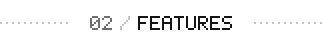</picture>

</div>

<div align="center">

<picture><source media="(prefers-color-scheme: dark)" srcset=".github/assets/feature-formats-dark.svg"></picture> <picture><source media="(prefers-color-scheme: dark)" srcset=".github/assets/feature-scripts-dark.svg"></picture>
<picture><source media="(prefers-color-scheme: dark)" srcset=".github/assets/feature-binaries-dark.svg"></picture> <picture><source media="(prefers-color-scheme: dark)" srcset=".github/assets/feature-sandbox-dark.svg"></picture>
<picture><source media="(prefers-color-scheme: dark)" srcset=".github/assets/feature-trace-dark.svg"></picture> <picture><source media="(prefers-color-scheme: dark)" srcset=".github/assets/feature-reports-dark.svg"></picture>

</div>

<details>
<summary><b>All formats and checks</b></summary>

| | |
|---|---|
| **Debian** | `.deb`, `.ipk` (OpenWrt) |
| **RPM** | `.rpm`, read by its own bounds-checked header parser |
| **Arch** | `.pkg.tar.zst` / `.xz` / `.gz` with `.INSTALL` and `.MTREE` |
| **Others** | Alpine `.apk`, Void `.xbps`, Slackware `.txz` / `.tgz` with `doinst.sh` |
| **Bundles** | AppImage (type 1 and 2), Snap, SquashFS |
| **Single files** | ELF executables and libraries, kernel modules, shell / Python / Perl scripts, makeself installers |
| **File tree** | install path, mode, owner, size, SHA-256; setuid, world-writable, hidden and device files highlighted |
| **Scripts** | preinst / postinst, `%pre` / `%post`, `.INSTALL`, `doinst.sh` with the lines that triggered a rule |
| **ELF** | PIE, NX, RELRO, canary, FORTIFY, RPATH / RUNPATH, notable imports, packers, libraries that re-implement libc (`LD_PRELOAD` rootkits) |
| **Integrity** | every file against the package's own checksums (`md5sums`, RPM digests, `.MTREE`) |
| **Heuristics** | more than 100 rules: download-and-run, reverse shells, cron / systemd / PAM / udev persistence, credential theft, miners, anti-forensics, destructive commands |
| **Indicators** | URLs, IPs, domains and `.onion` addresses, documentation links filtered out |

</details>

<a id="install"></a>

<div align="center">

<picture><source media="(prefers-color-scheme: dark)" srcset=".github/assets/label-install-dark.svg">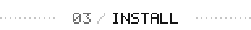</picture>

</div>

| your system | file from the [latest release](https://github.com/Trendorin/pkgscope/releases/latest) |
|---|---|
| **Arch Linux**, CachyOS, Manjaro | `pkgscope-1.0.0-1-x86_64.pkg.tar.zst` |
| **Debian 13** and newer | `pkgscope_1.0.0-1_amd64.deb` |
| **Fedora 44** and newer | `pkgscope-1.0.0-1.fc44.x86_64.rpm` |
| **any distribution** with glibc 2.35+ | `PkgScope-1.0.0-x86_64.AppImage`, nothing to install |

```sh
sudo pacman -U ./pkgscope-1.0.0-1-x86_64.pkg.tar.zst       # Arch
sudo apt install ./pkgscope_1.0.0-1_amd64.deb               # Debian
sudo dnf install ./pkgscope-1.0.0-1.fc44.x86_64.rpm       # Fedora
chmod +x PkgScope-1.0.0-x86_64.AppImage && ./PkgScope-1.0.0-x86_64.AppImage
```

Each package is built in a clean container of its distribution, installed and started there
before it is published. Check downloads with `sha256sum --ignore-missing -c SHA256SUMS`.

`./PkgScope-*.AppImage --cli FILE` runs the command line. Tracing needs `strace` and
`squashfs-tools` from your distribution; the packages pull them in.

<details>
<summary><b>Build from source</b></summary>

Needs CMake 3.19+, a C++20 compiler, Qt 6 and libarchive development files; tracing also needs
`strace` and `squashfs-tools` at run time.

```sh
git clone https://github.com/Trendorin/pkgscope && cd pkgscope
./install.sh                     # build + install to /usr/local
./install.sh --prefix ~/.local   # per user, no root
./uninstall.sh                   # removes exactly what was installed
```

</details>

<a id="quick-start"></a>

<div align="center">

<picture><source media="(prefers-color-scheme: dark)" srcset=".github/assets/label-quick-start-dark.svg">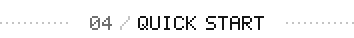</picture>

</div>

Open a file (or drop it on the window) and press **Inspect**. **Inspect & Trace** also runs the
installer in the sandbox. Every finding shows its severity, an explanation and the evidence.

<div align="center">

 

</div>

<a id="sandbox"></a>

<div align="center">

<picture><source media="(prefers-color-scheme: dark)" srcset=".github/assets/label-sandbox-dark.svg">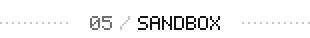</picture>

</div>

**Inspect & Trace** simulates the package manager (dpkg `preinst → unpack → postinst`, rpm
`%pre → unpack → %post`, pacman `pre_install → post_install`) as a fake root inside:

- user, mount, PID, IPC, UTS, cgroup and (by default) network namespaces: no root, no setuid helper;
- a **copy-on-write overlay** over `/usr`, `/etc`, `/opt`, `/var`, so nothing on your disk changes;
- a dropped capability bounding set, rlimits and a **seccomp** filter (module loading, `bpf`,
  `kexec`, mounts, new namespaces, `io_uring` and more are blocked);
- on Linux 6.12+, **Landlock** scoping: no host abstract sockets (X11, D-Bus), no signals outside.

The report shows the process tree, file activity with sensitive reads (also blocked ones), a
filesystem diff, network connections with DNS / SNI / HTTP hosts, and files dropped and run
during the install.

| if tracing does not start | |
|---|---|
| Ubuntu 24.04+ | the Debian package installs the AppArmor profile; from source: `sudo install -Dm644 packaging/apparmor/pkgscope-sandbox /etc/apparmor.d/` and `sudo apparmor_parser -r /etc/apparmor.d/pkgscope-sandbox` |
| `overlay … read-only` | `sudo modprobe overlay` (the packages load it at boot) |
| anything else | **Analyze → Check sandbox support** tells what is missing |

<a id="how-it-works"></a>

<div align="center">

<picture><source media="(prefers-color-scheme: dark)" srcset=".github/assets/label-how-it-works-dark.svg">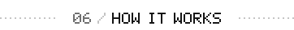</picture>

</div>

<div align="center">

<picture><source media="(prefers-color-scheme: dark)" srcset=".github/assets/flow-dark.svg"></picture>

</div>

```
src/core      no UI: format detection, ELF and RPM parsers, libarchive extraction that refuses
              traversal and symlink escapes, rules, strace parser, the sandbox orchestrator
src/sandbox   pkgscope-sandbox: a small Qt-free, non-setuid helper (namespaces, overlay, seccomp)
src/gui       Qt 6 Widgets window          src/cli_main.cpp   the same core, headless
```

<a id="security"></a>

<div align="center">

<picture><source media="(prefers-color-scheme: dark)" srcset=".github/assets/label-security-dark.svg">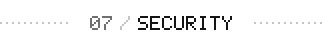</picture>

</div>

PkgScope reads hostile files, so it is built for that: static analysis never executes the
input; every parser is bounds-checked and has a libFuzzer harness that CI runs under
AddressSanitizer and UndefinedBehaviorSanitizer; extraction refuses path traversal, absolute
paths, symlink and hardlink escapes and strips setuid bits and device nodes (tested with crafted
archives); the sandbox helper is not setuid and drops everything before it runs the target.

A clean result means *nothing obvious was found*, not that a file is safe: one static pass and
one sandboxed run cannot prove that. Report vulnerabilities privately, see [SECURITY.md](SECURITY.md).

<a id="docs"></a>

<div align="center">

<picture><source media="(prefers-color-scheme: dark)" srcset=".github/assets/label-docs-dark.svg">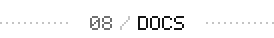</picture>

</div>

<div align="center">

<a href="https://github.com/Trendorin/pkgscope/releases/latest"><picture><source media="(prefers-color-scheme: dark)" srcset=".github/assets/link-download-dark.svg"></picture></a> <a href="#docs"><picture><source media="(prefers-color-scheme: dark)" srcset=".github/assets/link-cli-dark.svg"></picture></a>
<a href="SECURITY.md"><picture><source media="(prefers-color-scheme: dark)" srcset=".github/assets/link-security-dark.svg"></picture></a> <a href="CHANGELOG.md"><picture><source media="(prefers-color-scheme: dark)" srcset=".github/assets/link-changelog-dark.svg"></picture></a>

</div>

### Command line

```sh
pkgscope-cli FILE                                # static inspection
pkgscope-cli --trace FILE                        # also run it in the sandbox
pkgscope-cli --trace --allow-network FILE
pkgscope-cli FILE --json out.json --html out.html --md out.md
pkgscope-cli --trace --fail-on high FILE         # exit code 3 on a High finding (CI)
```

See also [CONTRIBUTING.md](CONTRIBUTING.md) · [SECURITY.md](SECURITY.md) · [CHANGELOG.md](CHANGELOG.md).

<div align="center">

<picture><source media="(prefers-color-scheme: dark)" srcset=".github/assets/eof-dark.svg"></picture>

<br>
<sub>MIT · made by <a href="https://github.com/Trendorin">Trendorin</a></sub>

</div>
